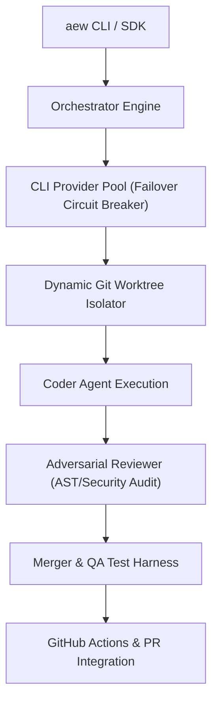

# Agentic Enterprise Workstation (AEW)

Enterprise-grade SDLC agentic orchestration engine inspired by Timon / Agentic Workstations.
Built for high-velocity software engineering fleets utilizing local subscription CLIs, dynamic Git worktrees, dual-model consensus verification, and automated GitHub PR governance.

## Architecture

## Features

- **Dynamic Git Worktree Isolation**: Zero race condition multi-agent development.
- **Provider Pool & Circuit Breakers**: Seamless fallback across available LLM backends.
- **Dual-Model Consensus Gate**: Generative coding verified by adversarial audit models.
- **Automated Local QA Runner**: Executes static checks, linting, unit tests, and secret leak scanning before merge.
- **Enterprise GitHub Actions Integration**: Ready-to-use workflows for CI/CD pipeline verification.
